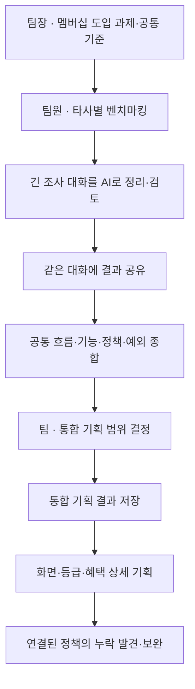
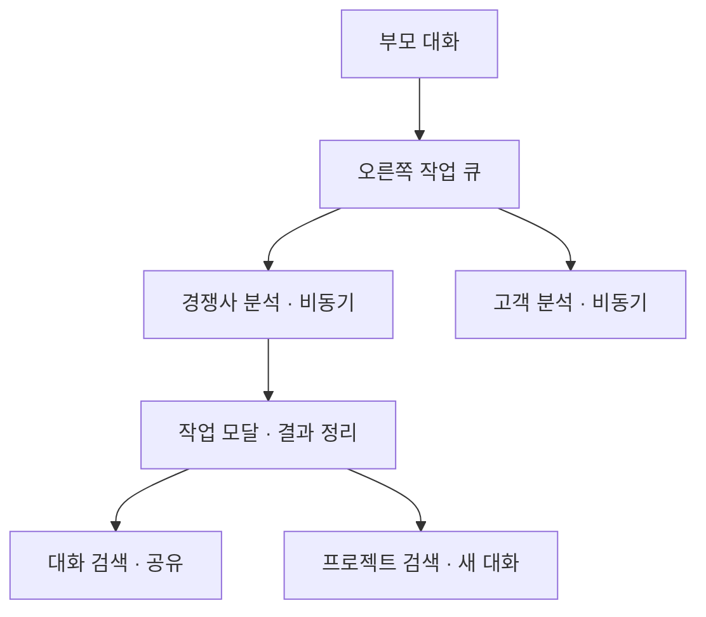
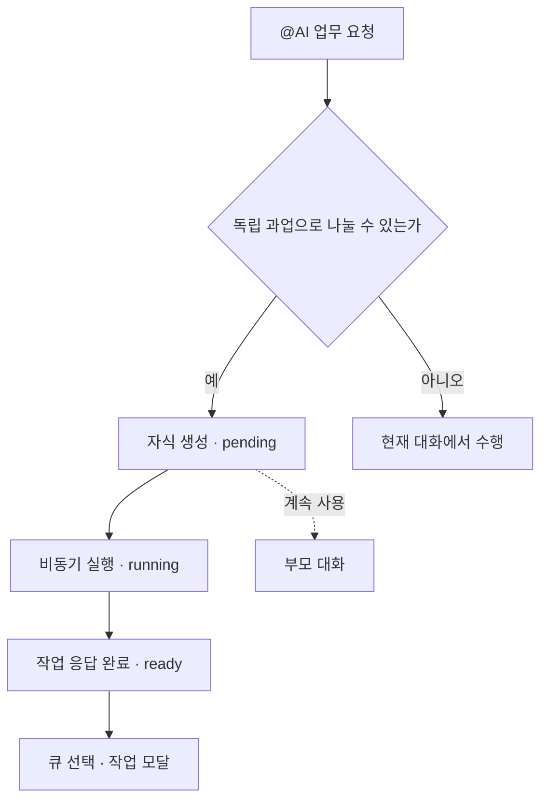
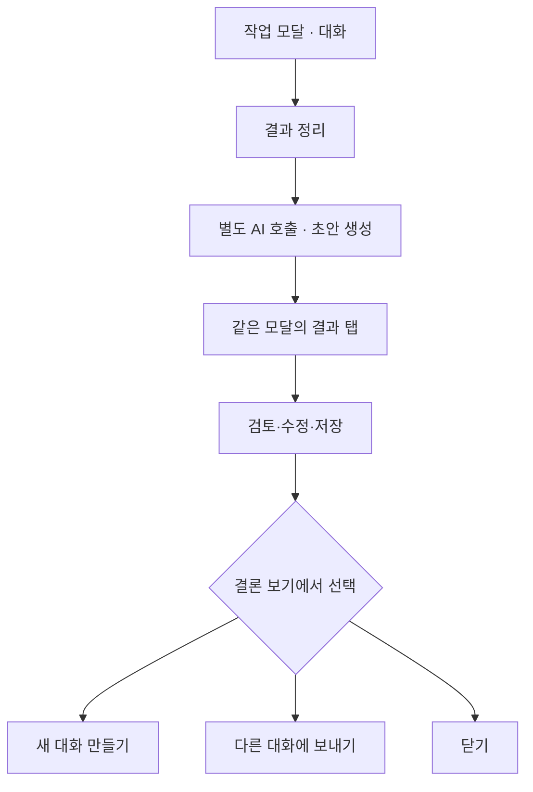
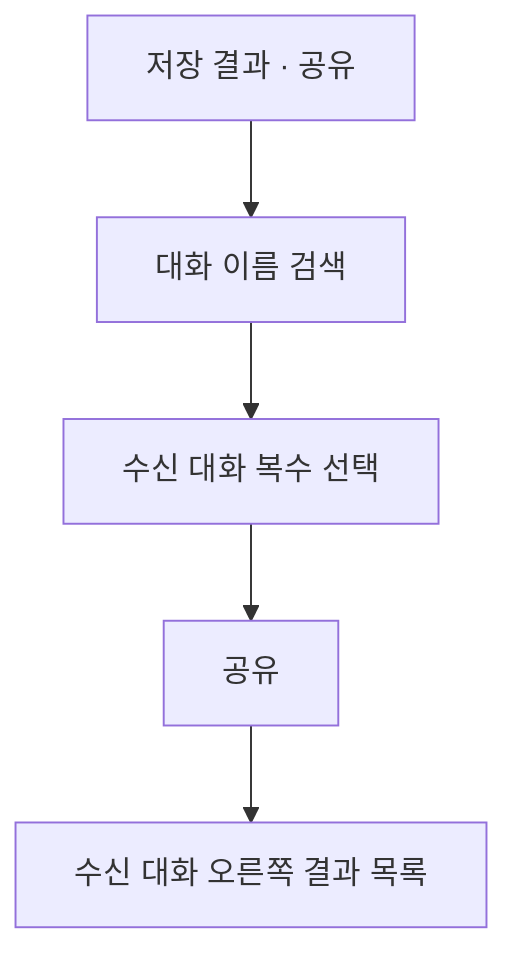
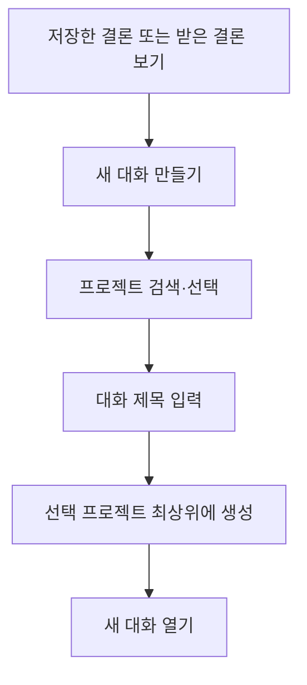
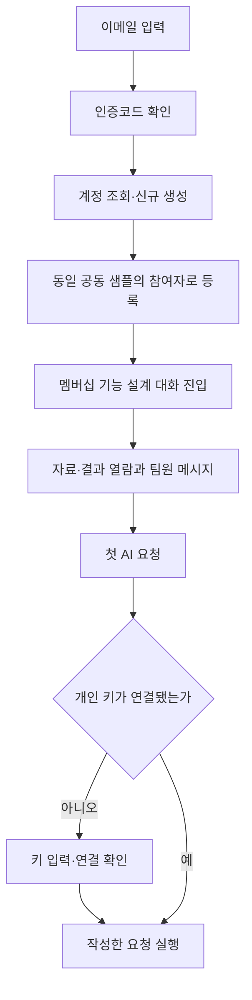

# ramus — AI 협업 워크스페이스 상위·상세 기획서

버전: 1.7 · 작성일: 2026-11-09 · 상태: 구현 전 제안  
연결 산출물: [메인 사용 흐름과 와이어프레임](AI_Workspace_Wireframes.html)

> 프로젝트 안에서 팀원과 AI가 대화하고, AI가 필요한 작업을 분기해 비동기로 수행한다. 사용자는 오른쪽 작업 큐에서 상태를 보고 모달로 작업을 열며, 대화를 결과로 정리해 필요한 곳으로 전달한다.

## 문서 안내

이 문서는 기능·정책·화면·사용 흐름을 상세하게 정의한다. **미니멀 원칙은 제품 UI의 라벨과 버튼에만 적용하며, 기획 문서와 와이어프레임의 설명·주석·검토 항목은 축약하지 않는다.**

- 상위 기획: 사용자 문제, 가치, 범위, 개념 관계.
- 상세 기획: IA, 플로우, 기능 동작, 권한·예외, 데이터, 수용 기준.
- 화면 설계: 화면별 사용자 맥락·주 행동·영역 주석·다음 화면·예외 상태.
- 와이어프레임: 제품 UI 미리보기와 외부 화면 설명을 분리한다.
- 이전에 합의한 자동 분기·작업 큐·모달·검색 공유·프로젝트 검색 기능은 유지한다.
- 메인 사용 시나리오는 **분산 벤치마킹을 신규 기능 기획으로 연결하기**로 정한다. 온라인 쇼핑몰의 멤버십 프로그램 도입을 예시로 사용한다.
- 시장·초기 고객의 조사 근거와 가설은 [별도 시장 조사 보고서](AI_Workspace_Market_Research.md)에 정리한다.
- MVP 로그인·공동 샘플·API 키·동시 작업·초기화 규칙은 **9장**에 정의한다. 모든 계정이 같은 샘플 워크스페이스를 사용하며 계정별 복제는 하지 않는다.

## 0. 이번 설계의 핵심 결정

| 영역 | 결정 |
|---|---|
| 프로젝트 | 워크스페이스 하나가 프로젝트 하나. 폴더·하위 워크스페이스 없음 |
| MVP 첫 진입 | 이메일 로그인 후 모든 계정을 동일 공동 샘플 워크스페이스에 편집 참여자로 등록 |
| 공통 자료 버전 | 수정은 새 버전 저장. 대화는 적용한 버전을 고정하고 명시적 적용으로만 변경 |
| AI 연결 | 첫 AI 실행 시 개인 OpenAI API 키 입력. 키 없는 계정도 공동 열람·메시지 작성 가능 |
| 대화 | 사람 논의와 AI 요청이 같은 대화에 존재. @AI + 단일 전송 |
| AI 실행 시작 | 작업 목록 작성·사람 간 업무 배정만으로 실행하지 않음. @AI 실행 요청이 기준 |
| 작업 분기 | 명시적으로 맡긴 범위 안에서 AI가 독립 과업을 나눠 실행. 별도 분배안 작성·승인 화면 없음 |
| 작업 목록 범위 | 오른쪽에는 실제 AI 실행 작업만 표시. 사람의 담당·마감·진척 관리는 MVP 제외 |
| 효율 제안 | 논의의 목적·범위가 불명확하면 짧게 분리 진행을 제안. 긴 설정 양식 없음 |
| 비동기 | 부모 대화는 계속 사용 가능. 자식 작업은 pending → running → ready |
| 열람 | 작업 큐 또는 트리의 자식 선택 → 작업 모달. 부모 본문을 자식 화면으로 교체하지 않음 |
| 결과 정리 | 작업 모달의 별도 ‘결과 정리’ 액션. 긴 대화에 AI를 다시 호출하여 초안 생성 |
| 기존 대화에 공유 | 대화 이름 검색 → 복수 선택 → 공유. 코멘트 입력 없음 |
| 결과로 새 대화 | 프로젝트 검색 → 대상 프로젝트 선택 → 제목 입력 → 그 프로젝트 최상위에 생성 |
| UI | 설명용 라벨·번호·정책 문구는 제품 화면에서 제거. 필요한 정보·상태·행동만 표시 |

---

# 1. 상위 기획 / PRD

서비스명은 **ramus**이며, 팀원과 AI가 함께 대화하고 작업과 결과를 연결하는 AI 협업 워크스페이스다. 서비스명은 영문 소문자로 표기한다.

## 1.1 문제와 목표

공통 스킬·자료 전달, AI에 일을 나누어 시키는 과정, 긴 대화에서 결과를 추출하는 과정, 여러 대화로 결과를 옮기는 과정이 사용자에게 반복된다.

메인 시나리오에서는 이 연결 비용을 줄여, 각자의 타사 벤치마킹을 하나의 신규 기능과 상세 기획 기준으로 이어가게 한다. 상충하는 주장을 정리하는 것보다 조사 항목·공통 패턴·정책·예외를 종합하는 과정을 중심으로 둔다.

| 사용자 문제 | 제품 해결 |
|---|---|
| 공동 업무 환경을 각자 설정 | 프로젝트 공통 스킬·자료 |
| 주제가 섞이고 단일 대화가 길어짐 | AI가 필요한 작업을 분리하거나 분리 진행 제안 |
| 자식 작업을 기다리느라 현재 업무 중단 | 비동기 큐와 독립적인 부모 대화 |
| 결과를 확인하려고 여러 대화로 이동 | 큐에서 작업 모달 열기 |
| 결과가 여러 메시지에 흩어짐 | AI가 대화를 다시 정리하고 검토 후 저장 |
| 결과를 옮기기 번거로움 | 대화 검색 공유 / 프로젝트 검색 후 새 대화 |

초기 사용자는 조사·분석·기획·검토를 나누는 소규모 팀이며 데스크톱 웹을 기준으로 한다. 개인 공간·비공개 대화는 MVP에 없다.

## 1.1.1 사용자 스토리와 검증 목표

| 사용자 | 상황·요구 | 기대 결과 | 검증 지표·행동 |
|---|---|---|---|
| 업무 요청자 | 여러 분석을 부탁하고 싶다 | 직접 대화를 하나씩 만들지 않아도 AI가 독립 과업 분리 | 자동 분기 생성·중복 여부 |
| 부모 대화 참여자 | 하위 작업이 진행 중이다 | 기다리면서 다른 논의 지속 | 하위 실행 중 부모 메시지·별도 요청 성공 |
| 작업 검토자 | 준비된 작업의 내용을 보고 싶다 | 부모를 떠나지 않고 모달에서 검토 | 큐 선택→모달→닫기 후 문맥 유지 |
| 결과 작성자 | 분석과 보완이 여러 메시지에 흩어졌다 | AI가 여러 메시지에서 결론 본문 하나를 정리 | 정리 범위·원문 근거 확인 및 수정 |
| 결과 수신자 | 다른 대화의 결과를 참고하고 싶다 | 공유 결과를 열어 필요한 버전 사용 | 참고 반영·새 버전 구분 |
| 후속 기획자 | 결과들을 다른 프로젝트에서 쓰고 싶다 | 프로젝트 검색 후 입력을 가진 대화 생성 | 검색→선택→정확한 대상·스냅샷 생성 |

수치 목표는 실제 사용성 검증 후 설정한다. 생성 속도뿐 아니라 잘못된 분기·불필요한 모달 이동·결과 재입력 횟수를 확인한다.

## 1.2 대표 시나리오: 분산 벤치마킹을 신규 기능 기획으로 연결하기

### 1.2.1 목적과 시연 기능

온라인 쇼핑몰에 **회원 등급과 구매 혜택을 제공하는 멤버십 프로그램**을 새로 추가한다. 팀장이 타사 쇼핑몰 조사를 나누고, 팀원들이 AI와 각각 조사한 내용을 모아 고객 흐름·등급 정책·혜택·예외 처리를 기획한다.

핵심 경험은 **분산 조사 → 검토된 결과 공유 → 하나의 기능 설계 → 공통 기준으로 상세 기획**이다. 팀원들의 주장이 다르다는 상황을 일부러 만들지 않는다.

멤버십은 안내·등급 산정·혜택 적용·마이페이지·취소 및 반품 영향을 연결하므로 단일 알림 기능보다 충분한 협업 범위를 갖는다. 시연의 중심을 보여주기 위해 구매 실적 기반의 일반 회원 등급·혜택으로 범위를 잡고, 유료 구독 결제·외부 제휴 정산은 다루지 않는다.

이하 정책과 타사 A·B·C는 사용 흐름을 설명하는 가상의 예시다. 실제 서비스의 기능을 조사한 결과로 제시하지 않는다.

### 1.2.2 사용자와 공동 과제

| 역할 | 책임 |
|---|---|
| 팀장 | 고객 문제·도입 목표·조사 기준·담당 범위 설정, 통합 기획과 범위 결정 |
| 팀원 A·B·C | 맡은 타사를 같은 기준으로 조사, 근거·정책·고객 흐름을 결과로 정리 |
| AI | 조사·분석·보완 보조, 독립 과업 실행, 긴 대화 결과 정리, 항목별 종합과 누락 탐색 |

공동 과제:

> 기존 쇼핑몰에 멤버십을 추가한다. 고객이 자신의 등급과 혜택을 이해하고 사용할 수 있도록 타사를 벤치마킹해 기능·정책·화면을 기획한다.

조직 가설은 디지털 제품 팀이며, PM·기획자·디자이너·리서처·운영 담당자가 함께 참여할 수 있다. 반드시 기획자 세 명이 같은 기능을 조사해야 한다는 뜻은 아니다. 팀원별 타사 조사 후 상세 설계 단계에서 역할별 영역을 나눈다.

### 1.2.3 단계 1: 팀장이 공통 기준과 조사 범위를 정한다

‘멤버십 도입’ 대화에서 목표와 제약을 공유하고 공통 벤치마킹 스킬·자료를 선택한다.

| 공통 조사 항목 | 확인할 내용 |
|---|---|
| 진입·안내 | 멤버십을 어디서 발견하고 어떤 혜택을 먼저 이해하는가? |
| 회원·등급 | 별도 가입이 필요한가? 등급과 승급·유지·하락 조건은 무엇인가? |
| 구매 실적 | 어떤 기간·주문을 집계하며 결제·구매 확정·반품 시 어떻게 바뀌는가? |
| 혜택 | 적립·쿠폰·배송 혜택을 어디서 확인하고 어떤 조건으로 사용하는가? |
| 마이페이지 | 현재 등급, 다음 등급까지의 조건, 사용 가능한 혜택은 어떻게 보이는가? |
| 예외 | 취소·반품·쿠폰 사용·혜택 만료를 어떻게 처리하는가? |
| 근거 | 확인한 화면·문서·출처, 직접 확인하지 못한 항목은 무엇인가? |

팀장은 A에게 쇼핑몰 A, B에게 쇼핑몰 B, C에게 쇼핑몰 C를 맡긴다. 각자 다른 회사를 조사하되 같은 질문에 답하도록 해서 결과를 비교·종합할 수 있게 한다. 이 사람 간 배정만으로 AI 실행이나 오른쪽 작업 항목을 생성하지 않는다. 각 담당자가 @AI에 조사·정리를 맡기면 실행을 시작한다.

완료 산출물: 공동 목표, 공통 조사 기준, 담당별 타사 범위.

### 1.2.4 단계 2: 팀원이 AI와 조사하고 필요한 과업을 나눈다

담당자는 자신의 조사 대화에서 자료를 확인하고 AI에 비교·정리·추가 검토를 요청한다. 목표가 명확한 독립 과업이 있으면 AI가 분기해 작업 큐에 등록한다. 팀원과 팀장은 다른 논의나 작업을 계속할 수 있다.

이 단계의 결과는 단일 응답으로 끝나지 않는다. 화면 확인, 문서 읽기, 추가 질문, 누락 보완이 여러 메시지에 쌓인다. 작업 모달의 대화 탭에서 과정을 읽고 필요한 보완을 요청한다.

예시 관찰 항목:

| 타사 조사 | 수집할 내용 |
|---|---|
| 쇼핑몰 A | 가입·안내, 등급 표시, 혜택 확인 흐름과 관련 정책 |
| 쇼핑몰 B | 같은 공통 항목. 특히 실적 집계·승급·반품 시 동작 확인 |
| 쇼핑몰 C | 같은 공통 항목. 특히 혜택 지급·사용·만료와 고객 안내 확인 |

특정 항목에 집중해도 다른 공통 항목을 생략한 것으로 취급하지 않는다. 확인하지 못한 내용은 미확인으로 남긴다.

### 1.2.5 단계 3: 긴 조사 대화를 결과로 추출한다

작업 모달의 ‘결과 정리’로 조사 범위 안의 메시지·자료를 AI가 다시 읽고 **결론 본문 하나**를 만든다. 고객 흐름·기능·정책 조사에서 도출한 핵심 내용을 연결된 문장으로 정리한다. 결론·근거·미결 사항·다음 행동으로 항목을 나누지 않는다. 원문 범위와 자료 버전은 결과의 출처 메타데이터로 보관한다.

팀원은 초안을 검토·수정해 승인 결과로 저장한다. 이후 다른 대화에 전달하는 것은 원본 전체가 아니라 이 정리된 결과의 고정 버전이다.

완료 산출물: 타사 A·B·C의 비교 가능한 멤버십 벤치마킹 결과.

### 1.2.6 단계 4: 결과를 한 대화에 모아 전체 기능을 설계한다

팀원들은 대화명을 검색해 ‘멤버십 기능 설계’ 대화에 결과를 공유한다. 부모 대화로 고정하지 않는다. 또는 결과들을 선택해 프로젝트 검색 후 새로운 기획 대화를 만들 수 있다.

팀장의 AI 요청 예시:

> @AI 세 쇼핑몰의 벤치마킹 결과를 공통 항목별로 모아줘. 공통 고객 흐름, 정책 선택지, 우리 서비스에 필요한 기능과 아직 확인하지 못한 항목을 정리해줘.

| 종합할 항목 | 목적 |
|---|---|
| 공통 고객 흐름 | 안내→등급 확인→혜택 확인·사용의 전체 경험 구성 |
| 기능 묶음 | 멤버십 안내, 등급, 실적, 혜택, 마이페이지의 관계 정리 |
| 정책 선택지 | 타사의 서로 다른 집계·등급·혜택 방식을 우리 조건에 맞게 검토 |
| 누락·미확인 | 자료가 없어서 알 수 없는 것과 실제로 제공하지 않는 것을 구분 |
| 연결 영향 | 반품으로 실적·등급·이미 지급한 혜택이 어떻게 영향을 받는지 정리 |
| 첫 구현 범위 | 이번에 필요한 핵심 흐름과 나중에 확장할 항목 결정 |

핵심은 기능 목록을 합치는 것이 아니라 화면·정책·상태가 서로 맞물리는 하나의 멤버십 경험을 만드는 것이다. AI는 미확인 정책을 사실처럼 보완하지 않는다. 필요한 경우 추가 조사나 운영 담당자 확인으로 연결한다.

### 1.2.7 단계 5: 공통 결정을 저장하고 상세 기획을 나눈다

팀은 자사 목적과 운영 여건을 바탕으로 예를 들어 구매 실적 기반 등급, 등급별 혜택, 마이페이지 안내를 첫 범위로 정한다. 수치·기간·예외는 벤치마킹을 그대로 복사하지 않고 자사 조건을 검토해 결정한다.

다음은 결론을 작성할 때 고려할 기획 내용이다. 별도 결과 필드나 고정 출력 템플릿이 아니며, 저장할 결과는 결론 본문 하나로 종합한다.

| 공통 기준 | 기획 시 고려할 내용 |
|---|---|
| 사용자·목표 | 고객이 등급과 혜택을 이해하고 사용하는 경험 |
| 전체 흐름·IA | 안내, 등급, 실적, 혜택, 주문·마이페이지 연결 |
| 정책 | 실적 기간·반영 시점·등급 변경·혜택 지급·사용 |
| 예외 | 취소·반품·혜택 만료·이미 사용한 혜택의 처리 |
| 범위·가정 | 첫 구현과 후속 범위, 아직 확정하지 않은 조건 |
| 근거 | 채택한 벤치마킹과 자사 운영 판단 |

공통 결과를 입력으로 상세 기획을 나눈다.

| 담당 영역 | 상세 기획 |
|---|---|
| 고객 흐름·화면 | 멤버십 안내, 마이페이지, 등급·혜택 표시와 상태 |
| 회원·등급 | 구매 실적 집계, 승급·유지·하락, 취소·반품 후 변경 |
| 혜택·운영 | 지급·사용·만료 조건, 예외 처리, 고객 문의 기준 |

각 담당자가 처음부터 배경을 다시 설명하지 않고 같은 통합 기획을 기준으로 시작한다. 필요한 경우 프로젝트를 검색해 구현 프로젝트의 새 대화로 이어간다.

### 1.2.8 후속 장면: 연결된 정책의 누락을 발견하면 보완한다

상세 기획 중 ‘반품으로 등급이 내려간 고객이 이미 받은 쿠폰을 사용한 경우’처럼 여러 영역에 걸친 항목이 발견될 수 있다.

- 담당자는 누락된 조건과 영향을 정리해 통합 기획 대화와 관련 상세 대화에 공유한다.
- 팀은 실적·등급·혜택의 처리 순서를 함께 검토한다.
- 통합 결과와 관련 정책을 새 버전으로 저장한다.
- 다른 대화는 새 버전을 확인하고 필요한 입력을 업데이트한다.

이는 상반된 주장을 억지로 조정하는 장면이 아니라, 나누어 설계한 내용을 연결하면서 누락을 발견하고 일관성을 맞추는 장면이다. 첫 시연의 필수 단계로 넣지 않고 후속 사례로 사용할 수 있다.

### 1.2.9 사용자 흐름

### 1.2.10 시연과 고객 검증에서 확인할 것

1. 공통 기준으로 조사한 결과가 항목별로 모이는가?
2. 긴 조사 대화에서 사실·가정·미확인 내용을 구분해 추출하는가?
3. 팀원이 결과를 복사·재입력하지 않고 통합 설계에 활용하는가?
4. 여러 타사의 참고 사례가 하나의 고객 흐름·정책으로 정리되는가?
5. 상세 담당자들이 같은 통합 결과로 시작하는가?
6. 영역 사이의 누락이 발견됐을 때 관련 대화로 전달하고 보완하는가?

초기 체험에서는 ‘예시 벤치마킹’이라고 표시한 자료와 결과를 준비할 수 있다. 심사위원이 키를 연결해 처음 실제로 실행할 과제는 이 결과들을 종합해 멤버십 구성안을 만드는 요청으로 둔다. 시연 자료가 실제 타사 조사인 것처럼 제시하지 않는다.

## 1.3 핵심 개념

| 개념 | 의미 |
|---|---|
| 프로젝트 / 워크스페이스 | 참여자·공통 자원·대화·결과물의 공동 범위 |
| 대화 | 사람 메시지와 AI 요청·응답의 기록 |
| 분기 작업 | 독립 목표를 비동기로 수행하는 자식 대화와 실행 단위 |
| 작업 큐 | 현재 대화에서 분기된 작업의 상태·결과 접근 목록 |
| 결과물 | 여러 메시지에서 추출·검토한 내용. 고정 버전으로 보관 |
| 공유 맥락 | 다른 대화가 전달받거나 AI 입력으로 사용하는 결과 버전 |

분기 작업에는 Task와 Conversation을 연결한다. 대화는 기록을, Task는 pending/running/ready 등 실행 상태를 책임진다. 모든 대화를 작업 큐에 넣지는 않는다.

## 1.4 위계와 맥락

- 새 일반 대화는 현재 프로젝트의 최상위에 생성한다.
- 작업 분기는 현재 대화 아래 자식으로 생성하고 큐에 등록한다.
- 자식은 트리에 나타나지만 선택하면 작업 모달로 열린다.
- 부모·자식은 출발 관계다. 결과는 형제·다른 최상위 대화에도 공유할 수 있다.
- 보고 있는 결론으로 새 대화를 만들 때는 프로젝트를 검색해 선택하며 대상 프로젝트의 최상위에 생성한다. 원본의 부모를 자동 상속하지 않는다.
- 프로젝트 간 이동도 가능하다. 생성 권한이 있는 프로젝트만 검색 대상이다.

## 1.5 MVP 범위

포함: 프로젝트 생성·선택, 공통 자원, 단톡방형 대화, AI의 제한된 자동 분기, 비동기 큐, 작업 모달, 결과 정리·버전, 대화 검색 공유, 프로젝트 검색 후 새 대화, 전체 결과 목록.

제외: 폴더, 개인 공간, 별도 분배안 화면, 다단계 자율 에이전트 재귀 실행, 외부 도구 연동, 일반 알림 센터, 실시간 공동 문서 편집, 복잡한 노드 재배치.

초기 AI 분기는 한 단계의 독립 과업으로 제한한다. 작업 내부에서 무한히 다시 분기하는 동작은 하지 않는다. 입력 파일 형식·모델·실행 한도는 기술 설계에서 확정한다.

---

# 2. IA와 화면 구조

## 2.1 IA

| 위치 | 내용 |
|---|---|
| 상단 프로젝트명 | 프로젝트 전환·새 프로젝트 |
| 왼쪽 대화 트리 | 최상위 대화, 분기 작업, 새 대화 |
| 왼쪽 결과물 메뉴 | 프로젝트 전체 결과, 선택 후 새 대화 |
| 왼쪽 스킬·자료 | 공통 자원 등록·선택 |
| 중앙 대화 | 현재 부모·최상위 대화의 메시지와 단일 입력창 |
| 오른쪽 작업 큐 | 작업 제목·상태. 클릭 시 작업 모달 |
| 오른쪽 공유받은 결과 | 결과 제목·새 버전 표시. 클릭 시 미리보기 |
| 작업 모달 | 제목·상태, 대화 / 결과 탭, 결과 정리 액션 |
| 공유 모달 | 대화명 검색, 선택한 대상, 공유 |
| 새 대화 모달 | 프로젝트 검색, 선택 결과, 제목, 만들기 |

작업 내용은 중앙 부모 대화에 펼치지 않는다. 중앙에는 AI가 분기했다는 짧은 메시지만 남기고 세부 진행·대화·결과는 큐와 모달에서 확인한다.

## 2.2 제품 화면의 최소 정보

| 영역 | 남길 정보 | 제거할 정보 |
|---|---|---|
| 대화 헤더 | 제목, 필요 시 상위 경로 | ‘공동 공간’, ‘토론 종류’ 등 반복 라벨 |
| 큐 | 제목, 상태 | 긴 실행 설명·과도한 버튼 |
| 작업 모달 | 대화·결과, 정리, 저장·공유 | 부모 정책·상속 정책의 상시 설명 |
| 공유 | 검색, 선택 대상, 공유 버튼 | 코멘트, 부모 고정 안내, AI 입력 정책 안내 |
| 새 대화 | 프로젝트 검색, 결과, 제목 | 대화 종류, 위치 선택기, 긴 생성 설명 |

화면 ID·흐름 설명은 와이어프레임 외부 검토 영역에서만 제공한다. 제품 내부에는 주석 번호를 넣지 않는다.

---

# 3. 메인 유저 플로우

## UF-00. 팀과 할 일을 정하고 AI와 나눠 진행하기

첫 화면의 목적은 팀의 목표·필요한 일을 논의하고, 그중 AI에게 맡길 일을 요청하는 것이다. 사람이 작업 목록을 완성해야만 AI를 사용할 수 있는 구조는 아니다.

1. 팀과 목표·필요한 일을 논의한다. 이 단계는 실행 지시가 아니다.
2. @AI로 수행할 일을 맡긴다. 넓은 요청도 목표와 범위가 충분하면 실행할 수 있다.
3. AI가 맡은 범위 안에서 필요한 작업을 나누고, 대화에는 짧게 진행 내용을 알린다.
4. 오른쪽 작업 목록에서 AI 작업을 확인한다. 팀원은 기존 논의를 계속하거나 분기된 작업 모달을 열어 보완한다.

예: “가입 흐름·혜택 구성·해지 정책을 살펴보죠”라는 팀원 메시지만으로 작업을 시작하지 않는다. “@AI 이 세 가지로 타사 벤치마킹을 나눠 진행해줘”라고 요청하면 세 작업을 만들어 실행한다. 동시에 “지훈님은 우리 배송비 정책을 확인해주세요”라는 사람 간 배정은 대화 메시지로 유지한다.

## UF-01. 자동 분기와 부모 대화 유지

ready는 ‘작업 실행이 끝나 내용을 열 수 있음’을 뜻한다. 최종 결과가 검토·저장됐다는 의미는 아니다. 큐가 ready가 되어도 자동으로 모달을 띄우거나 부모 입력을 중단하지 않는다.

## UF-02. 긴 대화의 결과 정리

결과 정리는 일반 채팅을 전송하는 동작과 분리한다. 작업 모달 상단의 액션으로 제공한다. 필요하면 이후 스킬 호출 메뉴에도 같은 액션을 연결할 수 있지만 두 경로를 필수로 만들지 않는다.

## UF-03. 기존 대화에 공유

공유 후 사용자를 수신 대화로 강제 이동하지 않는다. 원래 작업 모달을 유지한다. 수신 대화는 부모로 고정하지 않으며 코멘트 입력을 받지 않는다.

## UF-04. 결과로 새 대화

새 프로젝트를 만드는 동작이 아니다. 현재 프로젝트도 검색할 수 있으며 다른 접근 가능한 프로젝트도 선택할 수 있다. 기존 대화 공유를 거치지 않는다.

---

# 4. 상세 기능명세

## F-01. 단일 대화와 멘션

| 항목 | 동작 |
|---|---|
| 전송 | 입력창 하나·보내기 하나 |
| 일반 메시지 | 팀원 대화로 기록 |
| @AI | AI가 현재 대화와 참고 자료를 바탕으로 수행 |
| 효율 제안 | AI가 참여한 논의에서 목적 혼재·독립 과업을 발견하면 짧게 제안 |
| 부모 사용 | 자식 실행 중에도 일반 메시지와 별도 AI 요청 가능 |
| 실행 충돌 | 같은 대화의 중복 AI 실행만 제한. 자식 실행과 부모 실행은 별도 |

일반 메시지마다 AI가 장문의 답변을 끼워 넣지 않는다. 단순 질의·짧은 수정은 같은 대화에서 처리한다.

### 개발 준비 명세

| 항목 | 상세 정의 |
|---|---|
| 선행조건 | 프로젝트 참여자이며 대화에 접근 가능 |
| 트리거 | 단일 전송 버튼 또는 @AI 멘션 |
| 입력 | 본문·멘션 대상·참고 자료·현재 대화 |
| 핵심 동작 | 작성자·요청자와 함께 기록하고 AI 요청만 실행 |
| 완료 결과 | 사람 메시지 또는 AI 응답, 필요한 경우 분기 |
| 예외 | 빈 메시지·중복 실행 차단, 입력 유지 |
| 권한·접근 | 모든 참여자가 사용. 요청자·중단자 기록 |

수용 기준은 6.3의 해당 AC와 화면별 검토 항목으로 연결한다.

## F-02. AI의 자동 분기와 효율 제안

### 실행 시작 기준과 사람·AI 역할

핵심 원칙: **사용자는 일을 맡기고, AI는 맡은 범위 안에서 작업 구조를 정한다.** 팀이 할 일을 정하는 것과 AI에게 실행을 맡기는 것은 다르다.

| 대화 상황 | AI 동작 | 작업 생성 |
|---|---|---|
| “멤버십 도입에 필요한 일을 정해봅시다” | 사람 간 논의로 유지 | 없음 |
| “가입·혜택·해지를 각각 살펴보죠” | 작업 목록 작성으로 취급 | 없음 |
| “지훈님은 배송비 정책을 확인해주세요” | 사람 간 업무 배정으로 유지 | 없음 |
| “@AI 멤버십을 어떻게 기획하면 좋을까?” | 방법·접근 순서를 답함 | 없음 |
| “@AI 멤버십 도입을 위해 타사를 조사해줘” | 목적·범위가 충분하면 조사 시작, 필요한 구조를 스스로 정함 | 필요에 따라 생성 |
| “@AI 가입·혜택·해지로 벤치마킹을 나눠 진행해줘” | 명시한 세 범위로 나누어 실행 | 세 작업 생성 |

- 사람이 완성한 작업 목록은 필수 입력이 아니다. AI가 업무를 나누는 책임을 가진다.
- 단순한 @AI 호출만으로 실행 의도를 확정하지 않는다. 방법 질문과 실제 수행 요청을 구분한다.
- 실행 목적이나 범위가 크게 불명확할 때만 대화 안에서 짧게 확인한다.
- 오른쪽 목록은 AI가 실제 수행하는 작업과 상태만 관리한다. 사람의 담당자·마감·진척 관리는 MVP에서 제공하지 않는다.
- 수락용 별도 화면·분배안·추가 승인 버튼을 만들지 않는다. 기존 @AI 입력과 단일 전송을 사용한다.

### 자동 분기

AI가 이미 요청받은 업무를 수행하다가 독립된 목표·산출물을 가진 병렬 과업으로 나누는 것이 효율적이라고 판단하면 바로 하위 작업을 생성·실행한다. 사용자에게 별도 분배안 양식을 채우게 하지 않는다.

- 예: 경쟁사 분석과 고객 분석을 별도 작업으로 나누면 서로 기다리지 않고 진행 가능.
- 부모 본문: ‘경쟁사 분석과 고객 분석을 나눠 진행할게요.’ 정도의 짧은 메시지.
- 각 작업에 목표, 시작 입력, 출처, 선택 자원과 상태를 기록한다.
- 분기 시 부모가 선택한 스킬·자료 목록을 **초기 설정 상속**한다. 이후 부모 선택 변경은 자식에 자동 반영하지 않는다.
- 생성된 작업은 큐에서 중단할 수 있고 실패 시 재시도할 수 있다.

### 제안만 하는 경우

AI가 참여한 논의에서 목표가 불명확하거나 여러 주제가 섞인 경우에는 대화 안에서 짧게 분리 진행을 제안하거나 필요한 범위를 확인한다. 제안 자체로 작업을 실행하지 않으며, 사용자가 @AI에 실행을 요청하면 같은 자동 분기 경로를 사용한다. 별도 수락 버튼이나 승인 화면은 두지 않는다. 확정되지 않은 목표를 임의로 만들어 실행하지 않는다.

효율 판단은 과업 독립성·출력 목적·중복 논의를 기준으로 설계하며 실제 모델 평가로 보완한다. 와이어프레임의 분기 내용은 예시이며 실제 의미 판단 로직을 구현한 것은 아니다.

### 개발 준비 명세

| 항목 | 상세 정의 |
|---|---|
| 선행조건 | AI가 업무 수행 중이며 목표·독립 과업 식별 가능 |
| 트리거 | 명시적 수행 요청 이후 맡은 범위 안에서 자동 판단. 방법 질문·목록 작성·사람 간 배정은 실행 트리거가 아님 |
| 입력 | 독립 목표·시작 입력·자원 선택 목록 |
| 핵심 동작 | 자식 Conversation과 Task 생성 후 실행기에 등록 |
| 완료 결과 | 오른쪽 큐에 pending, 부모에는 짧은 진행 안내 |
| 예외 | 중복 과업·불명확 목표·재귀 분기를 제한 |
| 권한·접근 | 현재 프로젝트 범위. 분기 자원 선택은 초기 상속 |

수용 기준은 6.3의 해당 AC와 화면별 검토 항목으로 연결한다.

## F-03. 비동기 큐와 상태

| 상태 | 의미 | 사용자가 할 수 있는 일 |
|---|---|---|
| pending | 등록됐으며 실행 슬롯·입력 준비 대기 | 모달 확인·취소 |
| running | 자식 AI 작업 수행 중 | 모달 진행 확인·중단 |
| ready | AI 작업 응답 완료 | 모달에서 대화 검토·추가 요청·결과 정리 |
| failed | 실행 실패 | 사유 확인·재시도 |
| cancelled | 사용자 취소·중단 | 재시도 또는 그대로 보관 |

pending은 무기한 대기 상태가 아니다. 실행기가 접수해 running으로 전환하고 종료·실패를 동기화한다. 오래 대기하면 재시도 가능한 오류 상태로 처리할 기준을 기술 설계에서 정한다.

- 큐는 현재 대화에서 분기된 작업을 보여준다.
- 부모 대화와 작업 상태는 독립적이다. 자식 실행 중 부모 채팅을 잠그지 않는다.
- ready는 상태 표시만 바꾸고 모달을 자동으로 열지 않는다.
- 사용자가 큐 항목을 선택하면 작업 모달을 연다.
- 트리의 자식 작업을 눌러도 동일 모달을 연다.

### 개발 준비 명세

| 항목 | 상세 정의 |
|---|---|
| 선행조건 | 등록된 Task와 자식 대화 존재 |
| 트리거 | 실행기 상태 변경·큐 항목 선택 |
| 입력 | Task ID·상태·시각·오류 |
| 핵심 동작 | 상태 이벤트를 반영하고 클릭 시 모달 열기 |
| 완료 결과 | 부모 사용 가능, ready 항목은 열람 가능 |
| 예외 | 장기 대기·실패·취소·재시도 처리 |
| 권한·접근 | 참여자는 상태 조회·열람·중단 가능 |

수용 기준은 6.3의 해당 AC와 화면별 검토 항목으로 연결한다.

## F-04. 작업 모달

| 영역 | 동작 |
|---|---|
| 헤더 | 작업 제목·상태·닫기 |
| 대화 탭 | 작업 목표, 사람·AI 메시지, 진행 내역 |
| 입력창 | 추가 논의·@AI 보완 요청. 부모 입력창과 독립 |
| 결과 정리 | 작업 대화 전체·이후 변경을 별도 AI 호출로 정리 |
| 결과 탭 | 정리 초안·승인 버전, 수정·저장·공유·새 대화 |
| 닫기 | 부모 화면·입력 초안·스크롤 위치 유지 |

pending/running도 모달로 열어 진행을 볼 수 있다. 결과 정리는 작업 실행 종료 후 제공한다. 결과 정리 중 부모 대화는 계속 사용할 수 있다. 결과 정리 실패는 기존 작업 ready 상태와 승인 결과를 지우지 않는다.

### 개발 준비 명세

| 항목 | 상세 정의 |
|---|---|
| 선행조건 | 큐 또는 트리에서 작업 선택 |
| 트리거 | 행 클릭·탭 전환·닫기 |
| 입력 | 작업 대화·실행 상태·결과 버전 |
| 핵심 동작 | 모달에 해당 작업만 표시, 닫아도 실행 유지 |
| 완료 결과 | 원래 부모·입력 문맥 유지 |
| 예외 | 정리 중 닫기·작업 실패·보완 요청 충돌 |
| 권한·접근 | 작업 접근은 프로젝트 권한을 따름 |

수용 기준은 6.3의 해당 AC와 화면별 검토 항목으로 연결한다.

## F-05. 긴 대화의 결과 정리와 버전

결과는 응답 하나를 복사한 내용이 아니라 여러 메시지·자료에서 추출한 **결론 본문 하나**다. 출력 스키마의 사용자 본문 필드는 conclusion 하나이며 근거·미결 사항·다음 행동 필드는 생성하지 않는다. 출처·원문 범위·버전은 본문과 별도의 메타데이터로 보관한다.

| 항목 | 명세 |
|---|---|
| 시작 | 작업 모달의 ‘결과 정리’ |
| 범위 | 첫 정리는 현재 작업 대화, 업데이트는 이전 승인 결과와 이후 메시지 |
| 시점 | 정리 요청 시점의 메시지 범위·자료 버전 고정 |
| AI 처리 | 길면 구간별 핵심 추출 후 종합. 원문 근거 범위 유지 |
| 출력 | 결론 본문 하나. 근거·미결 사항·다음 행동 별도 항목 없음 |
| 검토 | 모달 결과 탭에서 수정·저장. 초안은 공유하지 않음 |
| 버전 | 같은 결과 ID의 v1·v2. 각 버전은 고정 |
| 변경 이후 | 새 버전 표시. 수신 대화에 연결된 입력 버전은 자동 교체하지 않음 |

확인되지 않은 내용을 확정된 결론처럼 작성하지 않는다. 결론을 왜곡할 수 있는 조건은 필요한 범위에서 본문 문장에 포함하되 별도의 미결 사항 목록은 만들지 않는다. 원문 확인은 작업 모달의 대화 탭과 보관된 출처 정보로 가능하다. 내부 추론이나 전체 대화를 그대로 옮기지 않는다.

같은 정리 작업을 반복 클릭하면 중복 실행하지 않는다. 승인 결과가 이미 있으면 ‘다시 정리’로 업데이트하며 기존 버전은 유지한다.

### 개발 준비 명세

| 항목 | 상세 정의 |
|---|---|
| 선행조건 | 작업 응답 완료. 기존 메시지·자료 존재 |
| 트리거 | 모달의 결과 정리 또는 다시 정리 |
| 입력 | 정리 범위·기준 시점·이전 승인 결과·이후 메시지 |
| 핵심 동작 | 별도 AI 호출→초안 검토·수정→버전 저장 |
| 완료 결과 | 승인 결과 v1 또는 기존 결과의 새 버전 |
| 예외 | 정리 실패·중복 실행·범위 변경·원문 한도 |
| 권한·접근 | 참여자 검토·저장, 검토자·저장 시점 기록 |

수용 기준은 6.3의 해당 AC와 화면별 검토 항목으로 연결한다.

## F-06. 대화명 검색으로 공유

| 항목 | 명세 |
|---|---|
| 진입 | 저장한 결론 또는 받은 결론의 ‘다른 대화에 보내기’ |
| 검색 범위 | 현재 프로젝트의 접근 가능한 다른 대화 |
| 검색 정보 | 대화 제목, 같은 이름이면 상위 경로 |
| 선택 | 여러 대화를 칩으로 선택·해제 |
| 전송 | 저장된 결과의 특정 버전을 각 대상에 참조로 전달 |
| 수신 | 오른쪽 공유받은 결과 목록에 표시하고 해당 결과 버전을 대상 대화의 AI 입력 자료로 연결 |
| 화면 유지 | 원래 작업 모달 유지. 대상 대화로 이동하지 않음 |
| 제외 UI | 코멘트·부모 고정 설명·정책 경고 문구 |

동일 결과 버전·대상 조합은 중복 전달하지 않는다. 자기 자신은 선택할 수 없다. 보내기를 완료하면 대상 대화의 ConversationInput에 해당 버전 스냅샷을 연결하므로 이후 그 대화의 AI 요청에서 사용한다. 별도의 참고 적용 버튼이나 수신자 승인 단계는 없다. 전달 자체로 AI를 실행하지 않는다. 받은 결론을 열거나 닫는 동작은 이미 연결된 입력을 추가·제거·변경하지 않는다. 원본 새 버전이 생겨도 기존 입력은 바뀌지 않는다.

### 개발 준비 명세

| 항목 | 상세 정의 |
|---|---|
| 선행조건 | 승인 결과 버전과 현재 프로젝트의 수신 가능 대화 |
| 트리거 | 공유→대화명 검색→복수 선택→확정 |
| 입력 | 결과 버전·선택 대화 IDs |
| 핵심 동작 | 대상별 Share와 ConversationInput을 함께 생성하고 같은 모달의 결론 보기로 복귀 |
| 완료 결과 | 수신 목록에서 확인 가능하며 후속 AI 요청의 입력 자료에 포함. 자동 실행 없음 |
| 예외 | 0개 선택·동일 대상 중복·동명 대화 구분 |
| 권한·접근 | 수신 가능한 대화만 검색. 코멘트 입력 없음 |

수용 기준은 6.3의 해당 AC와 화면별 검토 항목으로 연결한다.

## F-07. 프로젝트 검색으로 결과 기반 새 대화

| 항목 | 명세 |
|---|---|
| 진입 | 저장한 결론 또는 받은 결론 보기의 ‘새 대화 만들기’ |
| 입력 | 현재 보고 있는 결론의 고정 버전 1개, 프로젝트 검색, 대화 제목 |
| 검색 범위 | 사용자가 대화를 생성할 수 있는 프로젝트. 현재 프로젝트 포함 |
| 생성 위치 | 선택 프로젝트의 최상위 |
| 생성 자료 | 선택한 승인 버전의 내용·출처 스냅샷 |
| 결과 | 새 프로젝트가 아닌 새 대화 하나 생성 |
| 이동 | 생성한 대화로 진입 |

다른 프로젝트로 보낼 때는 선택한 결과 버전만 대상 대화의 입력 스냅샷으로 가져간다. 원본 대화 전체, 프로젝트 공통 자원, 스킬 설정을 함께 복사하지 않는다. 대상 프로젝트의 팀원이 사용하게 될 자료는 선택한 결과 내용이다. 생성 패널의 결과 목록과 대상 프로젝트로 이를 확인할 수 있게 한다.

원본 결과는 출처 프로젝트에 유지하고 기존 참조는 바꾸지 않는다. 다른 프로젝트에 가져온 입력이 원본 수정으로 자동 바뀌지 않도록 한다. 원본 접근 권한이 있는 사용자만 출처 대화를 열 수 있다.

### 개발 준비 명세

| 항목 | 상세 정의 |
|---|---|
| 선행조건 | 선택한 승인 결과와 대화 생성 권한이 있는 프로젝트 |
| 트리거 | 새 대화→프로젝트 검색·선택→만들기 |
| 입력 | 프로젝트 ID·제목·결과 버전 목록 |
| 핵심 동작 | 대상 최상위에 대화 생성, 선택 결과 스냅샷 입력 |
| 완료 결과 | 대상 프로젝트의 새 대화로 진입 |
| 예외 | 권한 변경·검색 0건·빈 제목·원본 접근 제한 |
| 권한·접근 | 대상 생성 권한 확인. 원본 전체·설정 복사하지 않음 |

수용 기준은 6.3의 해당 AC와 화면별 검토 항목으로 연결한다.

## F-08. 결과물·공통 자원

- 결과물 목록에는 현재 프로젝트의 승인 결과들을 모아 표시한다.
- 결과물 목록은 조회용이다. 목록에서 다중 선택해 새 대화를 만드는 기능은 제공하지 않는다.
- 공통 스킬·자료는 검색해 선택·적용한다. 최초 등록은 v1, 수정은 새 버전이며 F-09의 규칙을 따른다.
- 자원 선택은 대화 설정에서 관리하며 입력창을 복잡하게 만들지 않는다.
- 단순 새 대화는 현재 프로젝트에 만들고, 결과 기반 새 대화는 프로젝트 검색을 사용한다.
- 부모·자식 이외의 대화도 결과를 공유받을 수 있다. 공유 결과 목록은 작업 큐와 분리한다.

### 개발 준비 명세

| 항목 | 상세 정의 |
|---|---|
| 선행조건 | 프로젝트 접근 및 결과·자원 존재 또는 등록 필요 |
| 트리거 | 결과물/스킬·자료 메뉴 |
| 입력 | 결과 선택 또는 자원 이름·내용·선택 목록 |
| 핵심 동작 | 승인 결과 통합 조회, 자원 등록·선택 적용 |
| 완료 결과 | 결과 조회 또는 현재 대화의 적용 자원 |
| 예외 | 빈 자원·초안 결과·파일 처리 실패 |
| 권한·접근 | 공통 등록과 대화별 적용 범위 구분 |

수용 기준은 6.3의 해당 AC와 화면별 검토 항목으로 연결한다.

## F-09. 팀 공통 스킬·자료의 버전 관리

### 목적과 범위

팀은 공통 기준을 한 번 등록한 뒤 계속 개선한다. 누가 어떤 기준으로 AI 작업을 실행했는지 재현할 수 있어야 하며, 공통 기준을 수정했다고 진행 중인 작업이나 기존 대화의 입력이 바뀌어서는 안 된다. 스킬의 지침뿐 아니라 공통 텍스트·첨부 자료에도 같은 버전 규칙을 적용한다.

| 동작 | 정책 |
|---|---|
| 최초 등록 | 동일 자원 ID 아래 v1 생성. 이름·설명·지침 또는 파일 내용과 작성자·시각 보관 |
| 수정 | 기존 내용을 덮어쓰지 않고 v2·v3를 생성. 저장한 새 버전이 프로젝트의 최신 버전 |
| 이력 조회 | 버전 번호·작성자·저장 시각을 보여주며 선택한 과거 버전의 내용을 읽을 수 있음 |
| 새 대화에 적용 | 이름·설명으로 검색해 최신 버전을 선택. 선택 칩과 상세에 버전 표시 |
| 기존 대화 | 현재 적용 버전을 고정. 최신 버전이 있어도 자동 교체하지 않음 |
| 버전 갱신 | 검색 화면에 현재 v1·최신 v2를 표시. v2를 선택해 적용하면 현재 대화의 이후 요청부터 사용 |
| 과거 버전 사용 | 이력에서 과거 버전을 확인하고 해당 버전을 명시적으로 적용할 수 있음 |
| 하위 작업 | 생성 시 부모의 자원 ID와 정확한 버전 ID를 초기 상속. 이후 부모의 갱신은 비연동 |
| 실행 중 | 실행 시작 시 입력 스냅샷 고정. 새 버전 저장·대화 설정 변경은 이미 실행 중인 Run에 영향 없음 |
| 파일 변경 | 파일을 교체해도 새 버전으로 저장. 과거 원본 파일·추출 내용은 해당 버전에 보관 |
| 다른 프로젝트 | 결과 전송·새 대화 생성은 결론 버전만 전달. 원본 공통 자료의 전체 내용·설정은 복사하지 않음 |

AI 응답과 결과 정리 실행의 입력 스냅샷에는 실제 사용한 자원 버전 ID를 기록한다. 대화 설정의 버전 변경으로 과거 메시지·저장된 결론을 다시 생성하지 않는다. 최신 버전이 있다는 사실은 스킬·자료 검색 화면에서만 간단히 표시하며 별도 알림 기능은 추가하지 않는다.

### 저장과 적용의 구분

공통 자료의 새 버전 저장은 프로젝트 자원을 갱신하는 행동이고, 적용은 특정 대화의 AI 입력 기준을 변경하는 행동이다. 저장 후에는 같은 모달의 상세로 돌아오며 어떤 대화에도 새 버전을 강제 적용하지 않는다. 사용자가 현재 대화에 적용을 누를 때만 해당 대화의 선택 버전을 바꾼다.

### 화면과 사용 흐름

1. 스킬·자료에서 이름을 검색한다. 현재 대화가 사용하는 v1과 최신 v2를 함께 확인한다.
2. 자원 이름 또는 버전 이력을 선택하면 같은 모달의 상세·이력 화면(WF-17)으로 전환한다.
3. 수정(WF-18)에서 내용을 바꾸고 새 버전 저장을 누른다. 저장 후 상세에 새 버전이 표시된다.
4. 상세·이력에서 사용할 버전을 확인하고 현재 대화에 적용한다. 검색 결과에서 최신 버전을 선택해 적용할 수도 있다.
5. 이후 @AI 요청이 적용한 버전을 사용한다. 기존 대화·하위 작업·실행 스냅샷은 유지된다.

모달은 목록·상세/이력·수정 화면 사이에서 내용만 전환한다. 추가 모달, 차이 비교 편집기, 브랜치·병합, 일괄 갱신·되돌리기는 MVP 범위에서 제외한다. 과거 버전을 적용하는 것과 프로젝트 최신 버전을 되돌리는 것은 다르며, 후자는 제공하지 않는다.

### 예외와 수용 기준

- 이름·지침이 비거나 파일 처리가 실패하면 새 버전을 저장하지 않는다. 기존 최신 버전은 유지한다.
- 저장 기준 버전이 v2인데 다른 팀원이 먼저 v3를 저장한 경우 저장을 중단한다. 입력 초안은 유지하고 최신 내용을 확인하도록 안내한다. 자동 덮어쓰기·자동 병합은 하지 않는다.
- 같은 내용의 반복 저장과 요청 재전송으로 중복 버전을 만들지 않는다.
- 공동 샘플의 편집 참여자는 버전을 등록·수정할 수 있다. 작성자는 실제 계정으로 기록하며 별도 승인 역할은 추가하지 않는다.
- 재현 시나리오: A가 v1을 적용한 채 B가 v2를 저장해도 A의 이후 요청은 v1을 사용한다. A가 v2를 명시적으로 적용한 뒤 시작한 요청만 v2를 사용한다.

---

# 5. 화면별 메인 사용 흐름과 와이어프레임

와이어프레임은 제품 UI와 검토 설명을 분리한다. 사용 흐름 선택기는 제품 바깥에 있고, 제품 안에는 필요한 버튼·제목·상태만 남긴다.

| ID | 화면·상태 | 사용자의 목적 | 주 행동·전환 |
|---|---|---|---|
| WF-01 | 부모 대화 | 팀 논의·AI 요청 | @AI 업무 요청 → 자동 분기 |
| WF-02 | 큐 pending | 분기됐음을 확인 | 부모 대화 계속 사용 |
| WF-03 | 큐 running | 비동기 진행 확인 | 부모 논의·다른 요청 유지 |
| WF-04 | 큐 ready | 준비된 작업 확인 | 큐 항목 선택 |
| WF-05 | 작업 모달·대화 | 작업 내용 열람·보완 | 결과 정리 |
| WF-06 | 작업 모달·결과 | AI 정리 초안 검토 | 수정·저장·공유·새 대화 |
| WF-07 | 공유 검색 모달 | 기존 대화에 전달 | 대화 검색·복수 선택·공유 |
| WF-08 | 받은 결론 보기 | 결론 확인·사용처 선택 | 같은 모달에서 새 대화 만들기 / 다른 대화에 보내기 / 닫기 |
| WF-09 | 전체 결과물 | 승인 결과 조회 | 조회 전용. 목록에서 새 대화 생성 없음 |
| WF-10 | 공통 자원 | 스킬·자료 관리 | 등록·선택 |
| WF-11 | 결과로 새 대화 모달 | 목적 프로젝트에 후속 대화 생성 | 프로젝트 검색·선택·제목·만들기 |

WF-02·03·04는 같은 부모 대화의 큐 상태다. WF-05·06은 같은 작업 모달의 두 탭이다. WF-07은 같은 모달의 본문을 대화 검색 화면으로 전환하는 단계이며, 완료 후 결론 보기로 돌아간다. 모달 위에 다른 모달을 띄우지 않는다.

## 5.1 작업 큐의 최소 표현

- 헤더: ‘작업’과 항목 개수.
- 항목: 작업 제목 + 대기 중 / 진행 중 / 준비됨 상태.
- 준비된 항목을 누르면 모달. 항목마다 원본보기·결과보기·열기 버튼을 반복하지 않는다.
- 상세 중단·재시도는 모달에 둔다.

## 5.2 결과 정리의 최소 표현

- 작업 모달 헤더에 ‘결과 정리’. AI 멘션·질문을 다시 타이핑할 필요 없음.
- 정리 중 결과 탭에 진행 상태.
- 초안 편집 영역과 저장.
- 승인 후 공유·새 대화. 승인 전에는 두 행동을 제한한다.
- 원문은 대화 탭에서 확인. 긴 도움말을 상시 띄우지 않는다.

## 5.3 두 검색의 구분

| 행동 | 검색할 대상 | 생성·변경 대상 |
|---|---|---|
| 기존 대화에 공유 | 대화 이름 | 선택한 기존 대화의 결과 목록 |
| 결과로 새 대화 | 프로젝트 이름 | 선택한 프로젝트의 새 최상위 대화 |

---

# 6. 데이터·예외·수용 기준

## 6.1 최소 데이터

| 대상 | 주요 정보 |
|---|---|
| Project | ID, 이름, 참여자, 생성 권한, 공동 샘플 여부·시드 버전 |
| Account | ID, 인증된 이메일, 표시 이름 |
| Membership | 계정 ID, 프로젝트 ID, 역할. 동일 계정·프로젝트 조합 중복 방지 |
| AIConnection | 계정 ID, 비공개 자격증명 참조, 연결 상태 |
| Conversation | 프로젝트 ID, 제목, 부모 ID(선택), Task ID(선택), 메시지 |
| Task | 원본 대화, 자식 대화, 목표, 상태, 실행 ID, 시작·종료 시각 |
| Run | 대상 대화·작업, 목적(업무·결과정리), 상태, 실제 자원 버전 ID를 포함한 입력 스냅샷, 요청자·자격증명 소유 계정 ID |
| Result / Revision | 출처 대화, 버전, conclusion 본문 하나, 원문 범위·자료 버전 메타데이터, 검토자 |
| Share | 결과 버전, 수신 대화, 공유자 |
| ConversationInput | 대상 대화, 원본 결과 버전, 내용·출처 스냅샷 |
| Resource | 프로젝트 ID, 자원 ID, 종류, 최신 버전 ID |
| ResourceRevision | 자원 ID, 버전 ID·번호, 이름·설명·지침 또는 파일·추출 내용, 작성자·저장 시각, 저장 기준 버전 |
| ConversationResource | 대화 ID, 자원 ID, 적용한 버전 ID. 최신 버전으로 자동 해석하지 않음 |

## 6.2 예외

| 상황 | 처리 |
|---|---|
| 큐 대기 지연 | 실행기 상태를 확인하고 재시도 가능한 오류로 전환 |
| 작업 실패·중단 | 부모 유지, 큐 상태만 변경, 재시도 가능 |
| 작업 모달 닫기 | 작업 계속 실행, 부모 대화·초안 유지 |
| 결과 정리 실패 | 승인 버전 유지, 정리 재시도 |
| 승인 전 공유 | 저장하도록 안내 |
| 공유 대상 없음 | 공유 비활성 |
| 같은 대화명 | 프로젝트 내 경로로 구분 |
| 프로젝트 검색 결과 없음 | 결과 없음 표시. 새 프로젝트를 자동 생성하지 않음 |
| 생성 권한 변경 | 생성하지 않고 다른 프로젝트 선택 안내 |
| 원본 새 버전 | 기존 참고 스냅샷 유지, 명시적 업데이트 |
| 같은 작업·정리 중복 요청 | 기존 실행 사용 또는 중복 방지 |

## 6.3 수용 기준

| ID | 확인 조건 |
|---|---|
| AC-01 | 단일 전송 버튼과 @AI로 대화 가능 |
| AC-02 | 분배안 화면 없이 AI가 독립 과업을 큐에 등록 |
| AC-03 | pending → running → ready 상태 동기화 |
| AC-04 | 자식 실행 중 부모 메시지·다른 요청 가능 |
| AC-05 | 큐 클릭은 모달을 열고 중앙 대화를 바꾸지 않음 |
| AC-06 | ready가 되어도 모달 자동 열림 없음 |
| AC-07 | 모달의 별도 결과 정리 액션이 추가 AI 호출 수행 |
| AC-08 | 여러 메시지에서 결론 본문 하나만 생성하고 검토·수정·버전 저장. 근거·미결·다음 행동 필드 없음 |
| AC-09 | 대화 검색·다중 전송 시 각 대상의 AI 입력 자료에 고정 버전 연결. 별도 참고 적용·코멘트·자동 AI 실행 없음 |
| AC-10 | 공유 후 원래 작업 모달 유지 |
| AC-11 | 결과 기반 새 대화에서 프로젝트 검색 필수 |
| AC-12 | 선택 프로젝트 최상위에 결과 입력 대화 생성 |
| AC-13 | 다른 프로젝트에는 선택한 결과 버전만 전달 |
| AC-14 | 결과물 목록은 조회만 제공하고 목록에서 새 대화 생성 불가 |
| AC-15 | 분기 스킬·자료의 정확한 버전 ID를 초기 상속하며 이후 부모 변경 비연동 |
| AC-16 | 공통 자료 최초 등록 v1, 수정 시 새 버전. 과거 내용·작성자·시각 조회 가능 |
| AC-17 | 새 버전 저장만으로 다른 대화·하위 작업·실행 입력이 바뀌지 않음 |
| AC-18 | 검색·이력에서 특정 버전을 명시적으로 적용하고 이후 AI 요청에서 사용 |
| AC-19 | 동시 수정의 기준 버전 충돌 시 초안 보존·덮어쓰기 차단 |

## 6.4 검토 시나리오

1. @AI에 복합 분석을 부탁하고 큐가 생기는지 확인한다.
2. 대기·진행 중 부모 대화에 메시지를 보내 입력이 막히지 않는지 본다.
3. 준비된 큐 항목을 눌러 모달이 뜨고 부모 화면이 그대로인지 본다.
4. 결과 정리를 눌러 초안을 확인·수정·저장한다.
5. 공유에서 대화명 일부를 검색해 둘 이상 선택한다. 공유 후 모달 유지 여부를 본다.
6. 같은 결과로 새 대화를 만들며 프로젝트명 일부를 검색한다. 선택 프로젝트에 생성되는지 본다.
7. 수신 대화에 결론 버전이 AI 입력 자료로 연결됐는지 확인한다. 수신·열람만으로 AI 실행이 발생하지 않는지 확인한다.
8. 결과물 목록에서 새 대화 생성 기능이 없는지 확인한다.

## 6.5 구현 조건과 미리보기 범위

실제 제품은 서버 실행기·작업 상태 동기화·대화별 실행 격리·자동 분기 판단·결과 정리 모델·원문 스냅샷·권한 기반 검색을 구현해야 한다. 와이어프레임은 유저 플로우별 정적 화면 그림이며 모달도 그림 안에 포함한다. 실제 동시 접속·AI 호출·작업 진행은 MVP에서 서버와 연결해 구현해야 하며 와이어프레임 그림이 이를 수행하는 것은 아니다.

이 문서는 PRD·IA·흐름·기능·화면을 연결한 초안이다. 구성 참고: [Manyfast 기획 에디터](https://manyfast.io/features/editor/). 기존 기능 설명을 복제하지 않고 본 서비스의 메인 사용 흐름과 상세 정책에 맞춰 구성했다.

# 7. 화면별 상세 설계·주석

아래 설명은 제품 UI 밖의 설계 정보다. 와이어프레임에도 같은 내용을 화면별로 표시한다. 미니멀 제품 UI를 위해 상세 기획을 생략하지 않는다.

## WF-01. 부모 대화

| 항목 | 정의 |
|---|---|
| 사용자 | 프로젝트 참여자 |
| 진입 | 프로젝트 진입 또는 최상위 대화 선택 |
| 목표 | 팀원과 논의하고 AI에 업무를 요청한다. |
| 주 행동 | @AI 메시지 전송 |
| 완료·다음 화면 | 독립 과업이면 WF-02, 단순 요청이면 현재 대화 |
| 관련 기능 | F-01 · F-02 |

### 영역별 동작 주석

1. 사람 메시지와 AI 요청은 입력창·전송 버튼 하나를 사용한다.
2. 자동 분기 시 부모에는 짧은 진행 안내만 표시한다. 상세 작업 내용은 큐와 모달에 둔다.
3. AI가 수행 중 독립된 과업을 발견하면 자동 분기한다. 목표가 불분명하면 짧게 제안한다.

### 예외·검토 상태

- 빈 메시지 전송 방지
- 현재 대화의 AI 실행 중복만 제한. 자식 실행은 별도

## WF-02. 작업 큐 · pending

| 항목 | 정의 |
|---|---|
| 사용자 | 업무 요청자 및 팀원 |
| 진입 | AI가 독립 과업을 생성한 직후 |
| 목표 | 분기한 작업이 등록됐음을 확인하고 현재 논의를 계속한다. |
| 주 행동 | 부모 대화 계속 사용 |
| 완료·다음 화면 | 실행기 접수 후 WF-03 |
| 관련 기능 | F-02 · F-03 |

### 영역별 동작 주석

1. 오른쪽 큐의 각 행에 제목과 대기 중 상태를 표시한다.
2. 생성 시 부모의 스킬·자료 선택 목록을 초기 상속한다.
3. 대기는 실행 슬롯·입력 준비 상태이며 사용자 확인을 기다리는 상태가 아니다.

### 예외·검토 상태

- 장기 대기·실행기 접수 실패는 오류·재시도 상태로 전환
- 큐 생성만으로 모달을 자동 열지 않음

## WF-03. 작업 큐 · running

| 항목 | 정의 |
|---|---|
| 사용자 | 부모 대화 참여자 |
| 진입 | 하위 실행기가 작업을 시작함 |
| 목표 | 작업을 기다리면서 다른 논의·업무를 진행한다. |
| 주 행동 | 부모 메시지 전송 또는 다른 AI 요청 |
| 완료·다음 화면 | 작업 완료 시 WF-04, 진행 열람 시 WF-05 |
| 관련 기능 | F-01 · F-03 |

### 영역별 동작 주석

1. 하위 실행 상태는 서버 이벤트로 갱신한다.
2. 부모 입력창은 계속 사용하며 진행 상태 때문에 잠그지 않는다.
3. 작업을 중단해도 부모 기록과 다른 하위 실행은 유지한다.

### 예외·검토 상태

- 부분 실패는 해당 큐 항목에만 표시
- 동일 작업의 중복 실행 방지

## WF-04. 작업 큐 · ready

| 항목 | 정의 |
|---|---|
| 사용자 | 결과 검토자 |
| 진입 | 하위 AI 실행 응답이 완료됨 |
| 목표 | 내용을 확인할 작업을 선택한다. |
| 주 행동 | 큐 행 선택 |
| 완료·다음 화면 | WF-05 작업 모달 |
| 관련 기능 | F-03 · F-04 |

### 영역별 동작 주석

1. 준비됨은 작업 응답 완료이며 결과 검토·승인 완료가 아니다.
2. 행 전체가 열기 동작이다. 열기·원본·결과 버튼을 행마다 반복하지 않는다.
3. 대화 트리의 자식을 선택해도 같은 작업 모달로 연결한다.

### 예외·검토 상태

- 완료 시 모달을 자동으로 열지 않음
- 여러 작업이 완료되어도 부모 대화 위치 유지

## WF-05. 작업 모달 · 대화

| 항목 | 정의 |
|---|---|
| 사용자 | 하위 작업 검토·보완 담당자 |
| 진입 | 작업 큐 또는 트리의 자식 선택 |
| 목표 | 부모를 떠나지 않고 자식의 대화·진행을 확인한다. |
| 주 행동 | 추가 메시지·@AI 보완 또는 결과 정리 |
| 완료·다음 화면 | 정리 실행 후 WF-06, 닫으면 부모 화면 |
| 관련 기능 | F-04 · F-05 |

### 영역별 동작 주석

1. 모달의 대화 탭은 해당 자식 작업의 메시지만 보여준다.
2. 모달을 닫아도 하위 실행·결과 정리 실행은 계속된다.
3. 헤더의 결과 정리는 일반 대화 전송과 분리한 독립 액션이다.

### 예외·검토 상태

- pending/running에서는 상태 확인·중단 제공
- ready 이후 결과 정리 가능, 실패 시 재시도

## WF-06. 작업 모달 · 결과

| 항목 | 정의 |
|---|---|
| 사용자 | 결과 검토자 |
| 진입 | 결과 정리 실행·완료 또는 결과 탭 선택 |
| 목표 | 긴 대화에서 추출한 결론 본문 하나를 검토한다. |
| 주 행동 | 초안 수정·저장 후 공유 또는 새 대화 |
| 완료·다음 화면 | WF-07 기존 대화 공유 / WF-11 프로젝트 선택 |
| 관련 기능 | F-04 · F-05 |

### 영역별 동작 주석

1. AI 정리는 요청 시점의 메시지 범위와 자료 버전을 고정한다.
2. 초안과 승인 결과를 구분하며 승인 전 공유·새 대화 전송을 제한한다.
3. 업데이트 정리는 기존 결과의 새 버전이다. 과거 참고 입력은 변경하지 않는다.

### 예외·검토 상태

- 정리 실패 시 기존 승인 결과 보존
- 반복 클릭으로 정리 실행 중복 생성 방지

## WF-07. 대화 검색 · 공유

| 항목 | 정의 |
|---|---|
| 사용자 | 결과 공유자 |
| 진입 | 저장 결과에서 공유 선택 |
| 목표 | 필요한 기존 대화들에 결과를 전달한다. |
| 주 행동 | 대화명 검색·복수 선택·공유 |
| 완료·다음 화면 | 원래 작업 모달 유지, 수신 측은 WF-08 |
| 관련 기능 | F-06 |

### 영역별 동작 주석

1. 현재 프로젝트의 다른 대화를 제목으로 검색한다.
2. 같은 이름이면 상위 경로로 구분하고 선택 대상은 칩으로 표시한다.
3. 공유 완료 후 수신 대화로 강제 이동하지 않는다.

### 예외·검토 상태

- 선택 0개면 공유 비활성
- 자기 자신·동일 버전 중복 전달 제외
- 코멘트와 부모 고정 정책 문구는 제품 UI에 넣지 않음

## WF-08. 수신 대화 · 공유받은 결과

| 항목 | 정의 |
|---|---|
| 사용자 | 공유 대상 대화의 참여자 |
| 진입 | 결과를 받은 대화 진입 |
| 목표 | 필요한 결과를 열어 AI 참고 자료로 사용한다. |
| 주 행동 | 결론 확인 후 새 대화 만들기 / 다른 대화에 보내기 / 닫기 |
| 완료·다음 화면 | 새 대화는 WF-11, 보내기는 WF-07로 같은 모달에서 전환. 닫기는 원래 대화 복귀 |
| 관련 기능 | F-06 · F-07 |

### 영역별 동작 주석

1. 오른쪽 공유받은 결과는 작업 큐와 분리한다.
2. 수신 시 이미 해당 버전이 대상 대화의 AI 입력 자료로 연결된다. 결론 보기에서 추가 적용 절차는 없다.
3. 새 버전이 있어도 기존 참고 스냅샷은 직접 업데이트하기 전까지 유지한다.

### 예외·검토 상태

- 원본 대화 접근 권한과 결과 본문 사용 범위 구분
- 공유 수신만으로 AI 실행하지 않음

## WF-09. 프로젝트 전체 결과물 — 조회 범위

현재 프로젝트의 저장된 결론을 제목·출처·버전으로 조회한다. 결과물 목록에서 다중 선택하거나 새 대화를 만드는 기능은 제외하며, 해당 생성 와이어프레임도 제거했다. 새 대화 만들기는 저장한 결론 또는 받은 결론 보기에서 시작한다.

## WF-10. 공통 스킬·자료

| 항목 | 정의 |
|---|---|
| 사용자 | 공통 기준 관리자 또는 작업 참여자 |
| 진입 | 왼쪽 스킬·자료 메뉴 |
| 목표 | 공통 업무 기준을 등록하고 현재 대화에 적용한다. |
| 주 행동 | 검색·버전 확인·선택 적용 / 상세·버전 이력 / 새 버전 저장 |
| 완료·다음 화면 | 원래 대화로 복귀 |
| 관련 기능 | F-08 |

### 영역별 동작 주석

1. 자료 등록은 프로젝트 공통이며 실제 적용은 대화별 버전 ID로 고정한다. 검색 결과에 현재 적용 버전과 최신 버전을 표시한다.
2. 이름·버전 이력 선택은 같은 모달의 WF-17로 전환하고, 수정은 WF-18로 전환한다. 저장 후에도 현재 대화는 직접 적용하기 전까지 기존 버전을 사용한다.
2. 분기 시 선택 목록은 상속하지만 이후 부모 선택 변경은 자동 반영하지 않는다.
3. 다른 프로젝트로 결과를 옮겨도 원본 스킬·자료를 자동 복사하지 않는다.

### 예외·검토 상태

- 빈 자원 이름·내용 차단
- 처리에 실패한 파일을 조용히 제외하지 않음

## WF-11. 프로젝트 검색 · 결과로 새 대화

| 항목 | 정의 |
|---|---|
| 사용자 | 후속 대화 생성자 |
| 진입 | 결과 하나 또는 여러 개에서 새 대화 선택 |
| 목표 | 선택한 결과로 원하는 프로젝트에 새 대화를 만든다. |
| 주 행동 | 프로젝트 검색·선택·제목 입력·만들기 |
| 완료·다음 화면 | 대상 프로젝트 최상위 대화 |
| 관련 기능 | F-07 |

### 영역별 동작 주석

1. 현재 프로젝트뿐 아니라 생성 권한이 있는 다른 프로젝트도 검색한다.
2. 새 프로젝트를 만드는 것이 아니라 선택 프로젝트에 대화 하나를 만든다.
3. 선택한 승인 버전만 입력 스냅샷으로 가져오고 원본 대화·공통 설정은 유지한다.

### 예외·검토 상태

- 프로젝트 미선택·빈 제목은 생성 비활성
- 권한 변경 시 생성하지 않고 다른 대상 선택 안내
- 원본 새 버전은 대상 입력에 자동 반영하지 않음

# 8. 요구사항 추적과 검증 범위

| 요구사항 | 관련 기능 | 화면 | 수용 기준 |
|---|---|---|---|
| 통합 대화 | F-01 | 01·03 | AC-01·04 |
| 자동 분기·효율 제안 | F-02 | 01·02 | AC-02·15 |
| 비동기 큐·상태 | F-03 | 02·03·04 | AC-03·06 |
| 모달 열람·문맥 유지 | F-04 | 05 | AC-05·10 |
| 긴 대화 정리·승인 버전 | F-05 | 06 | AC-07·08 |
| 기존 대화 검색·다중 공유 | F-06 | 07·08 | AC-09·10 |
| 프로젝트 검색·후속 대화 | F-07 | 09·11 | AC-11·12·13·14 |
| 자원 공유·상속 | F-08 | 10·02 | AC-15 |

와이어프레임은 샘플 상태와 상호작용을 검토하는 산출물이다. 실제 AI 품질·분기 판단의 적정성·권한 검증·실행기 안정성은 제품 구현과 별도 테스트에서 검증한다.

# 9. MVP 계정·온보딩·공동 샘플 세팅

## 9.1 목적과 확정 방향

심사위원이 로그인해 이미 준비된 과제를 이해하고, 다른 계정과 **동일한 서버 데이터를 보면서 실제로 동시에 작업**할 수 있게 한다.

| 항목 | MVP 결정 |
|---|---|
| 로그인 | 이메일 인증. 본 절에서는 비밀번호 없는 인증코드 방식을 제안 |
| 기본 진입 공간 | 모든 계정이 동일한 공동 샘플 워크스페이스에 진입 |
| 계정별 복제 | 하지 않음. 샘플 프로젝트·대화·결과의 ID가 계정마다 달라지지 않음 |
| 참여 권한 | 로그인한 시연 계정은 공동 샘플에 편집 참여자로 자동 등록 |
| 동시 사용 | 다른 계정의 메시지·분기·실행 상태·결과·공유를 실시간 반영 |
| 키 입력 시점 | 처음 AI 동작을 실행하려는 때 입력. 로그인·열람의 필수 단계로 두지 않음 |
| 키 소유 | 계정별 개인 연결. 공동 공간이라고 키까지 공유하지 않음 |
| 재로그인 | 기존 계정·참여 관계를 재사용하고 같은 샘플 공간에 진입 |
| 초기화 | 로그인 때 초기화하지 않음. 운영자가 의도적으로 준비하는 절차로 분리 |

앞서 논의했던 계정별 샘플 복제 방식은 채택하지 않는다. 실제 협업 검증을 위해 한 사람이 만든 변경이 다른 사람에게 보이는 공동 상태가 필요하다.

## 9.2 공동 샘플의 초기 콘텐츠

기본 워크스페이스 이름은 ‘쇼핑몰 멤버십 도입 · 공동 체험’으로 제안한다. 환경에 지정한 고정 프로젝트 ID로 관리한다.

| 미리 준비할 항목 | 내용 | 초기 상태 |
|---|---|---|
| 공동 과제 | 기존 쇼핑몰에 회원 등급·혜택 멤버십 추가 | 목표·범위 확인 가능 |
| 공통 기준 | 멤버십 벤치마킹 스킬, 조사 항목, 가상 서비스 기본 정보 | 누구나 선택·참고 가능 |
| 조사 대화 | 쇼핑몰 A·B·C를 같은 기준으로 조사한 예시 메시지·자료 | 과정 열람 가능 |
| 조사 결과 | 고객 흐름·등급·실적·혜택·예외의 예시 정리 결과 | 비교·종합 입력으로 사용 가능 |
| 기능 설계 대화 | ‘멤버십 기능 설계’ | 팀장 과제만 있고 통합 기획은 아직 확정하지 않음 |
| 결과 목록 | 준비된 조사 결과와 이후 실제 저장 결과 | 같은 목록에서 출처·작성자로 구분 |

예시 타사 정보는 가상 자료임을 표시한다. 초기 메시지·결과에는 ‘예시·팀장’, ‘예시·조사 담당 A’처럼 예시 작성자를 사용하고, 로그인 이후 작업은 실제 계정의 작성자로 기록한다.

현재 실행되지 않은 작업을 pending/running으로 미리 띄워 실제 실행처럼 보이게 하지 않는다. 작업 큐는 실제 요청에 따라 생기는 실행을 추적한다. 예시 조사 대화를 열기 위해 과거 완료 상태를 저장하는 경우에도 예시임을 구분한다.

통합 설계를 완성해 두지는 않는다. 모든 사용자가 같은 결과를 바탕으로 내용을 보완하고 실제 통합 기획을 만들어볼 여지를 남긴다.

## 9.3 첫 로그인 플로우

- 첫 진입에서 워크스페이스 생성·템플릿 선택·샘플 복제 화면을 추가하지 않는다.
- 같은 이메일 재인증은 기존 계정을 사용한다. 로그인 반복으로 사용자나 참여 관계가 중복되지 않는다.
- 재로그인도 공동 샘플에 진입하며, 다른 사용자의 이전 작업을 포함한 현재 상태를 보여준다.
- 별도 초대 링크가 없어도 시연 계정들이 같은 공간에 참여한다. 추가 프로젝트 링크가 있을 경우에도 기본 공동 샘플 참여 관계는 유지한다.
- 다른 프로젝트에서 후속 대화를 만드는 기능을 시연할 때는 모든 시연 계정이 편집할 수 있는 별도의 예시 대상 프로젝트를 준비할 수 있다. 최초 기본 공간이 계정별로 달라지지는 않는다.

## 9.4 키 연결과 계정별 AI 실행

### 키가 없어도 가능한 일

공동 대화 열람, 메시지 작성, 결과 미리보기, 승인 결과의 공유, 결과를 입력으로 새 대화 생성 등 모델 호출이 필요 없는 행동은 가능하다.

### 키가 필요한 일

@AI 요청, AI의 자동 하위 작업 실행, 모달의 결과 정리, AI 보완·재시도에는 모델 연결이 필요하다.

| 상황 | 동작 |
|---|---|
| 키 없이 @AI 요청 전송 | 입력·첨부·대상 대화를 유지하고 연결 화면 표시. 연결 성공 후 해당 요청 실행 |
| 키 연결 취소 | 요청을 실행하지 않고 초안을 유지. 다른 공동 작업은 계속 가능 |
| 잘못된 키·호출 불가 | 연결 문제 안내·수정·재시도. 공동 공간에서 내보내지 않음 |
| 기존 연결 있음 | 별도 온보딩 없이 실행 |
| 다른 사용자의 작업 결과 정리 | 현재 정리 버튼을 누른 계정의 키로 별도 실행 |
| 요청에서 자동 분기한 하위 작업 | 최초 요청자의 자격증명 참조를 이어 사용 |
| 요청자 로그아웃 | 이미 접수한 실행은 서버에서 이어갈 수 있도록 설계. 키 참조 유효성은 실행기가 확인 |

키는 계정 설정에 연결하며 개인 워크스페이스를 만들지는 않는다. 원문 키를 공동 메시지·결과·자식 대화 입력·클라이언트 공유 이벤트에 포함하지 않는다. 다른 사용자는 요청자 이름과 실행 결과를 볼 수 있지만 키를 조회하거나 해당 키로 임의 실행할 수 없다.

연결 정보는 비공개 서버 저장소의 자격증명 참조로 관리하고 UI에는 연결 여부만 표시한다. 교체·연결 해제를 제공한다. 연결 해제 후 새 실행은 하지 않으며 진행 중 실행의 중단·자격증명 폐기 순서는 기술 설계에서 일관되게 처리한다.

첫 실제 AI 요청 예시:

> @AI 세 예시 벤치마킹 결과를 바탕으로 멤버십 안내·등급·혜택·예외를 하나의 기능 구성으로 정리해줘. 아직 정하지 않은 정책도 구분해줘.

키가 없는 심사위원도 다른 사람이 실행한 결과를 함께 보고 대화에 참여할 수 있다. 직접 모델 실행을 검증하려면 본인의 연결이 필요하다.

## 9.5 동시 작업과 충돌 처리

| 대상 | 동시 사용 규칙 |
|---|---|
| 사람 메시지 | 여러 계정이 같은 대화에 전송 가능. 서버가 순서·ID·작성자 확정 |
| 다른 대화의 AI 실행 | 계정별 연결로 병렬 실행 가능 |
| 같은 대화의 AI 실행 | 활성 실행 하나. 추가 요청자는 대기 안내를 받고 미전송 초안 유지 |
| 자동 분기 | 실행기·재전송이 같은 작업을 중복 생성하지 않도록 요청 ID 기준 처리 |
| 작업 큐 | 모든 계정에 pending/running/ready/failed/cancelled를 같은 서버 상태로 반영 |
| 작업 모달 | 각 사용자가 독립적으로 열고 닫음. 한 사람의 열람이 다른 사람의 화면을 바꾸지 않음 |
| 결과 정리 | 결과 초안별 단일 실행·검토를 추적. 같은 대상 중복 요청은 기존 실행 확인 또는 재시도 안내 |
| 결과 저장 | 최신 버전 확인 후 저장. 같은 버전에 대한 동시 변경은 덮어쓰지 않고 재확인 |
| 결과 공유 | 동일 버전·대상 중복 참조를 만들지 않음 |
| 네트워크 재접속 | 서버 상태를 다시 읽고 누락 메시지·현재 작업 상태 복구 |

실시간 공동 상태와 실시간 공동 문서 편집은 구분한다. 공동 메시지·큐·결과 변경은 즉시 함께 보되, 결과 초안 본문을 여러 사람이 동시에 편집하는 기능은 MVP 범위 밖이다. 검토 중인 초안의 저장 충돌은 버전 확인으로 방지한다.

일반 참여자는 공동 작업을 수행할 수 있다. 실제 비용이 발생하는 실행의 중단·재시도는 요청자와 운영자 범위로 관리하는 안을 제안한다. 이 MVP 권한 안이 다른 기능의 일반 권한 서술보다 구체적인 기준이다.

## 9.6 초기 데이터 생성·보존·리셋

1. 시연 환경 준비 시 고정 공동 프로젝트와 초기 예시 콘텐츠를 한 번 생성한다.
2. 로그인 시에는 기존 공동 프로젝트의 참여 관계만 추가·조회한다. 초기 예시를 계정마다 생성하지 않는다.
3. 두 명이 동시에 첫 로그인해도 프로젝트와 초기 콘텐츠가 중복 생성되지 않아야 한다.
4. 초기 콘텐츠에는 안정된 시드 식별자·버전을 두어 준비 절차 재실행 시 중복되지 않게 한다.
5. 일반 로그인·새로고침·재접속·다른 계정 참여는 데이터를 지우거나 초기화하지 않는다.
6. 시연 중 작성·분기·저장·공유한 내용은 공동 데이터로 남아 다른 계정과 재로그인 계정에 보인다.
7. 리셋은 운영자의 명시적인 시연 준비 작업으로만 수행한다. 다른 참여자가 사용 중인 공간을 로그인 이벤트로 리셋하지 않는다.
8. 리셋 전에 기존 작업 보존 필요성을 확인하고, 진행 중 실행이 없는 상태에서 준비한다. 일반 참여자에게 전체 초기화 버튼을 노출하지 않는다.

## 9.7 온보딩 화면 명세

| ID | 화면·상태 | 필요한 요소 | 완료 |
|---|---|---|---|
| ON-01 | 이메일 로그인 | 이메일 입력·인증코드 요청 | 코드 입력으로 이동 |
| ON-02 | 이메일 인증 | 코드 입력·재전송·이메일 수정 | 계정 확인·공동 참여 등록 |
| ON-03 | 공동 샘플 첫 진입 | 프로젝트 이름·실제 작성자·멤버십 과제·예시 자료 | 같은 대화에서 협업 시작 |
| ON-04 | 첫 AI 연결 | API 키 입력·연결·취소, 현재 요청 유지 | 확인 후 원래 요청 실행 |
| ON-05 | 연결 오류 | 오류와 키 수정·재시도 | 초안·공동 공간 유지 |

제품의 기존 대화 UI를 활용하고 별도의 긴 온보딩 투어는 두지 않는다. 처음 할 수 있는 행동은 예시 결과 확인과 단일 입력창의 @AI 요청이다.

## 9.8 심사위원용 실제 동시 사용 수용 기준

| ID | 검증 |
|---|---|
| ON-AC-01 | 서로 다른 이메일 세 계정이 로그인했을 때 프로젝트·대화·결과의 ID가 동일 |
| ON-AC-02 | A가 보낸 메시지가 새로고침 없이 B·C에 작성자와 함께 표시 |
| ON-AC-03 | A가 요청해 분기한 작업과 상태 변경이 B·C의 큐에도 표시 |
| ON-AC-04 | A의 하위 작업 실행 중 B가 부모 메시지를 보내고 C가 다른 대화에서 작업 가능 |
| ON-AC-05 | B가 작업 모달을 열어도 A·C의 화면은 바뀌지 않음 |
| ON-AC-06 | 키 없는 계정이 열람·메시지 작성 가능. 첫 모델 요청만 연결 단계로 이동 |
| ON-AC-07 | A의 키 원문이 B·C의 응답·이벤트·조회 결과에 노출되지 않음 |
| ON-AC-08 | B의 새 AI 요청·결과 정리는 B의 연결을 사용하고 A의 키를 임의 사용하지 않음 |
| ON-AC-09 | 같은 대화 중복 AI 요청·중복 분기·동시 결과 저장에서 상태·버전이 꼬이지 않음 |
| ON-AC-10 | 새로 로그인한 D도 A·B·C가 실제 작성한 현재 공동 상태를 확인 |
| ON-AC-11 | 재로그인·새로고침·동시 첫 로그인으로 데이터 복제·초기화·시드 중복 없음 |
| ON-AC-12 | 후속 대화의 프로젝트 검색에서도 공동 접근 가능한 대상 프로젝트를 확인 |

**정적 와이어프레임만으로는 이 기준을 검증할 수 없다.** 실제 MVP에서 별도 이메일·브라우저 세션을 사용해 메시지·큐·결과의 동기화와 실행자별 연결을 확인해야 한다.

## WF-17. 공통 스킬·자료의 상세와 버전 이력

검색 결과의 자원 이름·버전 이력에서 진입한다. 같은 모달에 선택 버전의 이름·본문·작성자·시각과 버전 목록을 표시한다. v1을 선택하면 v1 본문을 보여주고, 최신 v2는 별도로 표시한다. 하단은 현재 대화에 적용, 상단 수정은 최신 버전을 기준으로 WF-18로 이동한다. 이미 적용된 버전은 현재 적용으로 표시한다. 과거 버전 조회만으로 대화 설정은 바뀌지 않는다.

## WF-18. 공통 스킬·자료 수정과 새 버전 저장

WF-17에서 수정으로 진입한다. 기준 버전과 이름·설명·지침 또는 교체 파일을 편집하고 새 버전 저장을 누른다. 저장 성공 후 같은 모달의 WF-17에서 새 버전을 보여준다. 저장과 대화 적용은 별도 행동이다. 저장 충돌·검증 실패는 현재 입력을 유지하며, 취소는 저장 없이 상세로 돌아간다.
